<p align="center">
  
</p>

<p align="center">
  <a href="https://github.com/ishandutta2007/Awesome-Awesome-Awesome"></a><a href="https://discord.gg/jc4xtF58Ve"></a>
  <a href="https://github.com/ishandutta2007/Awesome-Test-Automation-Platforms/stargazers"></a>
  <a href="https://github.com/ishandutta2007/Awesome-Test-Automation-Platforms/network/members"></a>
  <a href="https://github.com/ishandutta2007/Awesome-Test-Automation-Platforms/blob/main/LICENSE"></a>
  <a href="https://github.com/ishandutta2007/Awesome-Test-Automation-Platforms/pulls"></a>
  <a href="https://github.com/ishandutta2007"></a>
</p>

---

# 🚀 Awesome Test Automation Platforms

> **A curated directory of top-tier SaaS platforms, cloud test execution grids, and open-source test automation frameworks.**  
> *Engineered for QA Architects, SDETs, DevOps Engineers, and Software Developers evaluating E2E testing, cross-browser validation, low-code authoring, and self-healing test systems.*

**Keywords / Topics**: `test-automation` • `software-testing` • `qa-automation` • `e2e-testing` • `browser-automation` • `playwright` • `selenium` • `cypress` • `cross-browser-testing` • `visual-regression` • `self-healing-locators` • `load-testing` • `api-testing` • `continuous-testing`

---

## 📖 Table of Contents

- [🌐 Sector Overview & Market Dynamics](#-sector-overview--market-dynamics)
- [💼 SaaS & Commercial Test Automation Platforms](#-saas--commercial-test-automation-platforms)
- [🔓 Open-Source Test Automation Frameworks & Tools](#-open-source-test-automation-frameworks--tools)
- [🎯 Selection Guide & Architectural Recommendations](#-selection-guide--architectural-recommendations)
- [🤝 How to Contribute](#-how-to-contribute)
- [📈 Star History](#-star-history)
- [💖 Support & Community](#-support--community)
- [⚖️ Disclaimer](#-disclaimer)

---

## 🌐 Sector Overview & Market Dynamics

- **Estimated Market Size & Trajectory:** The global software test automation market is valued between **$25 Billion and $35 Billion** (2024–2026) and is forecasted to surpass **$56 Billion to $92+ Billion by 2030**, expanding at a Compound Annual Growth Rate (CAGR) of **12% to 17%** as continuous deployment and AI-driven quality engineering become standard enterprise requirements.
- **Market Structure & Fragmentation:** The sector displays a **moderately fragmented** competitive dynamic rather than a winner-take-all monopoly. Enterprise giants (OpenText/Micro Focus, Tricentis, SmartBear, and BrowserStack) capture substantial high-margin corporate revenue across heavily regulated legacy environments (SAP, Oracle, Citrix, Windows desktop), while rapid innovation and fragmentation flourish across web, mobile, and cloud-native testing through vibrant open-source runtimes (Playwright, Selenium, Cypress) and AI-augmented self-healing startups.

---

## 💼 SaaS & Commercial Test Automation Platforms

The table below catalogs leading commercial platforms, sorted in descending order by **Company Size (Revenue / Valuation)**. All listed prices represent concrete starting tier figures, and free tier limits specify exact day durations and capability bounds.

| 🏢 Platform | 📊 Company Size (Valuation / Revenue) | 🎯 Core Testing Capabilities | 💵 Starting Tier Pricing | 🎁 Free Tier / Trial Limits |
| :--- | :--- | :--- | :--- | :--- |
| **[Micro Focus UFT One](https://www.opentext.com/)** (OpenText) | **$6.0B Acquisition** / **$5.8B Revenue** ($8.5B Market Cap) | Enterprise AI-powered GUI & API automation for SAP, Salesforce, mainframe, desktop, and web | **$3,200/seat/year** (node-locked license); **$8,500/year** (concurrent floating enterprise license) | **30-day free trial** (single full-featured evaluation node license; requires corporate business email) |
| **[Tricentis Tosca](https://www.tricentis.com/)** | **$4.5B Valuation** / **$500M ARR** (GTCR-backed) | Model-based codeless test automation, Vision AI image recognition for virtual desktops, and enterprise test data management | **€20,000/year** (~$21,500/yr) base Tosca Commander platform (or ~$10,000/seat/year modular licensing) | **14-day free trial** (cloud-hosted Tosca sandbox with pre-configured guided tour test workspaces) |
| **[BrowserStack](https://www.browserstack.com/)** | **$4.0B Valuation** / **$250M+ ARR** (Series B) | Instant access to 3,000+ real desktop browsers and real mobile devices on the cloud with automated Selenium/Playwright grid | **$129/month** ($1,548/year billed annually) for Automate Pro (1 parallel automated test runner) | **Free Forever plan** (100 automated test minutes + 30 minutes of live interactive cross-browser testing) |
| **[SmartBear TestComplete](https://smartbear.com/)** | **$2.0B Valuation** / **~$180M Revenue** (Vista / Francisco) | Windows desktop, web, and mobile UI automated testing supporting 7 scripting languages (Python, JS, VBScript, C#) | **$1,260/machine/year** (Base Desktop); **$7,595/user/year** (TestComplete Pro Node-Locked) | **14-day free trial** (unrestricted access to desktop, web, and mobile modules & TestExecute; no credit card required) |
| **[Sauce Labs](https://saucelabs.com/)** | **$750M Valuation** / **~$120M ARR** | Highly scalable cloud test execution grid for Playwright, Selenium, Appium, and real device mobile clouds | **$149/month** ($1,788/year billed annually) for Cross-Browser Automation (1 parallel test) | **14-day free trial** (100 automated test minutes + 60 live interactive minutes; no credit card required) |
| **[Applitools](https://applitools.com/)** | **$600M Valuation** / **~$25M ARR** (Thoma Bravo) | AI-powered Visual Regression Testing and Ultrafast Grid inspecting visual UI differences across browsers | **$667/month** ($8,004/year billed annually) for Starter Plan (unlimited users) | **14-day free trial** (unlimited visual comparisons) & **Free evaluation pool** (50–100 visual checkpoint units/month) |
| **[mabl](https://www.mabl.com/)** | **$500M Valuation** / **~$30M ARR** (Series C) | Intelligent low-code platform spanning web, API, and mobile testing with semantic intent-based self-healing | **$499/month** ($5,988/year billed annually) for Growth Tier | **14-day free trial** (unlimited local and cloud test runs across all supported browsers; no credit card required) |
| **[LambdaTest](https://www.lambdatest.com/)** | **$350M Valuation** / **~$30M ARR** (Series C) | HyperExecute ultra-fast AI-powered test execution cloud grid across 3,000+ browser environments | **$99/month** ($1,188/year billed annually) for Web Automation (1 parallel test runner) | **Free Forever plan** (60 minutes/month live interactive testing, 10 responsive tests, 1 parallel test execution) |
| **[Leapwork](https://www.leapwork.com/)** | **$312M Valuation** / **~$25M ARR** (KKR Series B) | Visual flowchart-driven no-code automation for business testers, Citrix virtualization, and enterprise ERP | **$22,000/year** (Base Enterprise agreement with 2 automation execution agents) | **30-day free trial** (full evaluation access to Leapwork Studio, Controller, and Agent runner for non-production use) |
| **[Katalon Studio](https://katalon.com/)** | **$250M Valuation** / **~$36M ARR** (Elephant VC) | Hybrid all-in-one IDE combining codeless record-and-playback with Groovy/Java scripting for Web, API, and Mobile | **$1,008/seat/year** ($84/seat/month billed annually) for Studio Professional | **Free Forever Studio tier** (unlimited local authoring & manual runs on desktop) + **30-day free trial** of True Automation |
| **[Ranorex Studio](https://www.ranorex.com/)** (Idera) | **~$150M Valuation** / **~$15M ARR** (Idera portfolio) | Robust UI automation with Ranorex XPath object recognition engine for desktop (WPF, .NET), web, and mobile | **$2,490/year** (Node-Locked Studio license); **$4,690/year** (Floating Enterprise license) | **14-day free trial** (fully functional evaluation with object spy, code generation, and test suite runner) |
| **[Worksoft Certify](https://www.worksoft.com/)** | **~$120M Valuation** / **~$38M ARR** (Marlin Equity) | Codeless continuous business process validation and compliance evidence capture for SAP, Oracle, and Salesforce | **$6,000/user/year** (base business process automation module) | **14-day guided sandbox PoC trial** (coordinated via enterprise sales discovery session; no self-serve download) |
| **[Testsigma](https://testsigma.com/)** | **$100M Valuation** / **~$10M ARR** (Accel-backed) | GenAI-driven low-code test automation in plain English for Web, Mobile, and APIs with unified test management | **$99/month** ($1,188/year billed annually) for Starter Plan (up to 5 concurrent runs) | **21-day free trial** (100 automated test runs, unlimited team members; no credit card required) |

---

## 🔓 Open-Source Test Automation Frameworks & Tools

Below are the top active open-source repositories powering modern test infrastructure, sorted in descending order by **GitHub Star Count**. Every badge links directly to the stargazers page of the repository.

1. **[Playwright](https://github.com/microsoft/playwright)** [](https://github.com/microsoft/playwright/stargazers)  
   **The modern standard for web browser automation.** Developed by Microsoft, Playwright delivers reliable cross-browser execution (Chromium, Firefox, WebKit) with built-in auto-waiting, network mocking, and the **Trace Viewer** for deep post-mortem failure analysis. Multi-language support across TypeScript/JavaScript, Python, C#, and Java.
   
2. **[Puppeteer](https://github.com/puppeteer/puppeteer)** [](https://github.com/puppeteer/puppeteer/stargazers)  
   **High-level Chrome DevTools protocol driver.** Maintained by the Google Chrome team, Puppeteer offers idiomatic Node.js control over headless Chrome and Chromium. Widely leveraged for single-page application rendering, automated PDF/screenshot generation, and granular performance diagnostics.

3. **[Cypress](https://github.com/cypress-io/cypress)** [](https://github.com/cypress-io/cypress/stargazers)  
   **Fast, developer-centric end-to-end testing.** Executes directly inside the browser's execution loop alongside application code, delivering instantaneous feedback, time-travel debugging, automatic waiting, and zero driver configuration for modern frontend frameworks (React, Vue, Angular).

4. **[Selenium](https://github.com/SeleniumHQ/selenium)** [](https://github.com/SeleniumHQ/selenium/stargazers)  
   **The foundational W3C standard for browser automation.** The pioneer of browser testing with unmatched language diversity (Java, Python, C#, Ruby, JavaScript). Backed by an extensive worldwide ecosystem and Selenium Grid for distributed test clustering across heterogeneous server fleets.

5. **[k6](https://github.com/grafana/k6)** [](https://github.com/grafana/k6/stargazers)  
   **Developer-friendly, high-performance load & stress testing.** Built in Go with modern ES6 JavaScript test scripting, k6 is engineered to catch performance regressions early in CI/CD pipelines with minimal system resource consumption.

6. **[Locust](https://github.com/locustio/locust)** [](https://github.com/locustio/locust/stargazers)  
   **Scalable user load testing in standard Python.** Define user behavior scenarios purely in Python code without awkward XML or bulky UIs. Capable of simulating millions of concurrent users distributed across networked worker machines.

7. **[Appium](https://github.com/appium/appium)** [](https://github.com/appium/appium/stargazers)  
   **Cross-platform mobile test automation standard.** Extends the W3C WebDriver protocol to iOS (XCUITest), Android (UiAutomator2/Espresso), and Windows desktop. Write tests for native, hybrid, and mobile web applications using identical APIs.

8. **[Nightwatch.js](https://github.com/nightwatchjs/nightwatch)** [](https://github.com/nightwatchjs/nightwatch/stargazers)  
   **End-to-end testing framework for web applications.** Written in Node.js and utilizing the W3C WebDriver API, Nightwatch provides an integrated test runner, built-in assertion library, and simple syntax for desktop and mobile browser automation.

9. **[Robot Framework](https://github.com/robotframework/robotframework)** [](https://github.com/robotframework/robotframework/stargazers)  
   **Generic keyword-driven test automation and RPA framework.** Open and extensible syntax enables cross-functional teams to automate acceptance tests and business processes with rich ecosystem libraries like SeleniumLibrary, Browser (Playwright-based), and RESTinstance.

10. **[WebdriverIO](https://github.com/webdriverio/webdriverio)** [](https://github.com/webdriverio/webdriverio/stargazers)  
    **Next-gen browser and mobile automation test runner for Node.js.** Supports both the official WebDriver standard and Chrome DevTools protocols. Offers modular plugins for Mocha, Jasmine, Cucumber, and seamless integrations with Sauce Labs, BrowserStack, and LambdaTest.

11. **[Karate](https://github.com/karatelabs/karate)** [](https://github.com/karatelabs/karate/stargazers)  
    **All-in-one test automation framework.** Unifies API testing, API performance testing, API mocking, and browser UI automation in a clean DSL without requiring extensive boilerplate code.

12. **[Allure 2](https://github.com/allure-framework/allure2)** [](https://github.com/allure-framework/allure2/stargazers)  
    **Multi-language test reporting framework.** Generates clear, interactive HTML reports with execution timelines, categorized failures, environment data, and historical trends for JUnit, TestNG, Pytest, Playwright, and Cypress.

13. **[QA Wolf](https://github.com/qawolf/qawolf)** [](https://github.com/qawolf/qawolf/stargazers)  
    **Playwright-backed test creation and parallel runner.** Converts user interactions into clean, maintainable Playwright TypeScript scripts that can be versioned in Git and executed in parallel across cloud workers.

14. **[Taurus (bzt)](https://github.com/Blazemeter/taurus)** [](https://github.com/Blazemeter/taurus/stargazers)  
    **Continuous testing orchestration wrapper.** Abstracts complex configurations for JMeter, Gatling, Locust, and Selenium into declarative, version-controlled YAML configuration files.

15. **[TestNG](https://github.com/testng-team/testng)** [](https://github.com/testng-team/testng/stargazers)  
    **Enterprise testing framework inspired by JUnit and NUnit.** Features parameterization, group dependencies, flexible execution suites via XML, and multi-threaded parallel test execution tailored for Java test suites.

16. **[Testsigma Community](https://github.com/testsigmahq/testsigma)** [](https://github.com/testsigmahq/testsigma/stargazers)  
    **Open-source low-code test automation platform.** Create automated tests for web, mobile apps, and APIs using natural language statements with built-in test management and local device execution.

17. **[playwright-automation-framework](https://github.com/yousufwaqar/playwright-automation-framework)** [](https://github.com/yousufwaqar/playwright-automation-framework/stargazers)  
    **Enterprise-grade Playwright + TypeScript framework.** Features Page Object Model architecture, axe-core WCAG 2.1 accessibility auditing, performance timing budgets, and Dockerized test execution.

18. **[pixelguard](https://github.com/emiliodominguez/pixelguard)** [](https://github.com/emiliodominguez/pixelguard/stargazers)  
    **Git-friendly visual regression testing.** Auto-detects Storybook component trees, captures baseline screenshots, and enables interactive CLI review for component design systems.

19. **[django-vrt](https://github.com/William-Blackie/django-vrt)** [](https://github.com/William-Blackie/django-vrt/stargazers)  
    **Python visual regression testing package for Django applications.** Employs a deterministic lockfile matrix (`djvrt.lock.json`), route discovery from URLConf, and interactive HTML visual diff reports.

20. **[playwright-go-framework](https://github.com/qambar/playwright-go-framework)** [](https://github.com/qambar/playwright-go-framework/stargazers)  
    **Structured Playwright testing framework written in Go.** Implements Page Object Model patterns, multi-browser GitHub Actions CI matrix builds, Docker execution, and HTML reporting for Go engineering teams.

21. **[mendwright](https://github.com/renaldstrakims/mendwright)** [](https://github.com/renaldstrakims/mendwright/stargazers)  
    **Local self-healing selector library.** Uses an offline local small language model (~1GB, Qwen2.5 fine-tuned) to repair broken CSS/XPath selectors in ~0.25 seconds without streaming page contents off-machine.

---

## 🎯 Selection Guide & Architectural Recommendations

```
                                  ┌───────────────────────────────┐
                                  │ What are your primary skills? │
                                  └───────────────┬───────────────┘
                                                  │
                      ┌───────────────────────────┴───────────────────────────┐
                      ▼                                                       ▼
        ┌───────────────────────────┐                           ┌───────────────────────────┐
        │  Code-First Engineers     │                           │  Non-Technical / Manual   │
        │  (TypeScript, Python, Go) │                           │  Testers & Business Teams │
        └─────────────┬─────────────┘                           └─────────────┬─────────────┘
                      │                                                       │
         ┌────────────┴────────────┐                             ┌────────────┴────────────┐
         ▼                         ▼                             ▼                         ▼
 ┌───────────────┐         ┌───────────────┐             ┌───────────────┐         ┌───────────────┐
 │ Modern Web    │         │ Multi-Platform│             │ Cloud SaaS    │         │ Enterprise    │
 │ (Fast E2E)    │         │ & Legacy Grids│             │ Low-Code      │         │ Desktop / SAP │
 └───────┬───────┘         └───────┬───────┘             └───────┬───────┘         └───────┬───────┘
         ▼                         ▼                             ▼                         ▼
  Playwright /              Selenium /                   mabl / Katalon /           Tricentis Tosca/
  Cypress / k6              Appium / Taurus               Testsigma / BrowserStack   SmartBear TestComplete
```

- **For Modern Web Applications:** Start with **Playwright**. Its auto-waiting mechanism, multi-browser engine support (Chromium, Firefox, WebKit), and Trace Viewer drastically reduce test flakiness and debugging overhead.
- **For Heterogeneous Language Environments:** Adopt **Selenium** with **Allure 2** reporting when you have established Java, Python, or C# automation suites requiring W3C standard compliance and multi-grid compatibility.
- **For Hybrid Skill Teams:** Evaluate **Katalon Studio** or **mabl** to enable non-programmers to compose test flows while granting engineers full scripting access.
- **For Regulated Enterprise Landscapes (SAP, Mainframe, Windows):** Leverage **Tricentis Tosca** or **Micro Focus UFT One** for end-to-end model-based business process certification.

---

## 🤝 How to Contribute

We welcome additions, corrections, and benchmark submissions from the community!

1. **Fork this repository** to your GitHub account.
2. **Add or modify** entries in `README.md` maintaining alphabetical consistency or correct sorting metrics.
3. **Include verified details**: Tool name, official URL, concise capability summary, concrete starting price, and exact free tier/trial boundaries.
4. **Submit a Pull Request** with a brief summary of the changes.

For major category additions or structural proposals, please open an Issue to discuss before submitting large PRs.

---

## 📈 Star History

[](https://star-history.dera.page/#ishandutta2007/Awesome-Test-Automation-Platforms&type=date&legend=top-left)

---

## 💖 Support & Community

Thank you for exploring this curated guide to **Awesome Test Automation Platforms**! If you find this directory valuable for your QA workflows, engineering team, or open-source stack:

- ⭐ **Star this repository** to help others discover it on GitHub.
- 🍴 **Fork the repo** to add your own tools, frameworks, and benchmarks.
- 📢 **Share it** with fellow SDETs, QA engineers, and DevOps practitioners.
- ☕ **Sponsor or buy a coffee**: Support ongoing maintenance and curation via the [GitHub Sponsor Dashboard](https://github.com/sponsors/ishandutta2007).

---

## ⚖️ Disclaimer

- This is a community-curated directory intended solely for educational, architectural, and procurement evaluation purposes.
- Product names, trademarks, and logos belong to their respective corporate entities.
- Pricing metrics, feature allocations, and free trial constraints are subject to change by vendors; always consult official vendor documentation for up-to-date commercial contracts.
